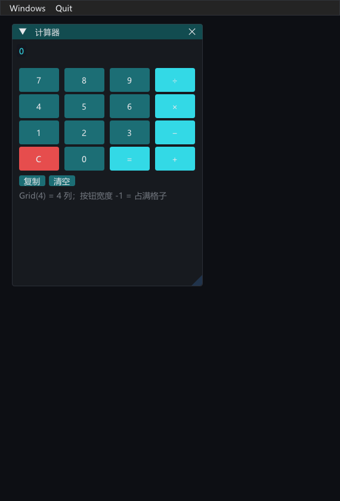

Echo 是一个 Dear ImGui 的 C++ 即时模式 UI 封装库。它把 ImGui 的立即模式调用包装成 `Window` / `Widget` / `Content` 的对象式接口，同时保留“每帧重画”。



## 许可证
本项目采用 MIT 许可证，详见 [LICENSE](../LICENSE)。
第三方依赖的许可证：
- GLFW：zlib/libpng，见 [LICENSES/GLFW.txt](../LICENSES/GLFW.txt)
- Dear ImGui：MIT，见 [LICENSES/ImGui.txt](../LICENSES/ImGui.txt)

## 前言：

#### 1.关于前置库问题

此仓库不包含前置开源库的内容，请自行下载前置库
**依赖：**
- **GLFW**（zlib/libpng 许可证）：
	- [LICENSES/GLFW.txt](../LICENSES/GLFW.txt)
    
    - 官网：[https://www.glfw.org/download.html](https://www.glfw.org/download.html)
        
    - GitHub：[https://github.com/glfw/glfw](https://github.com/glfw/glfw)
        
- **Dear ImGui**（MIT 许可证）：
	- [LICENSES/ImGui.txt](../LICENSES/ImGui.txt)
    
    - GitHub：[https://github.com/ocornut/imgui](https://github.com/ocornut/imgui)
        
    - 官网：[https://www.dearimgui.com/](https://www.dearimgui.com/)
#### 2.关于AI参与问题
事先说明，此项目后期代码大量依赖AI修改和完善。
核心设计和最初框架由本人独立搭建。

本项目采用 MIT 许可证。如你在使用过程中发现任何可能的许可或归属问题，欢迎提 issue，我会尽快处理。

## 编译与集成

Echo 是"头文件 + 源文件"的普通 C++ 库：不需要 CMake，也不用任何第三方构建系统。

**方式一：用自带的 `build.ps1`（推荐，Windows + MinGW-w64）**

```powershell
# 1) 把第三方源码放到 echo/libs/（仓库不收录它们）
#    libs\imgui\   ← Dear ImGui 源码（含 backends\ 与 misc\cpp\imgui_stdlib.cpp）
#    libs\glfw\    ← GLFW 的 Windows 预编译包（自带 include\ 与 lib-mingw-w64\）
# 2) 编译
cd echo
.\build.ps1              # 编出 build\libecho.a 和两个示例
.\build.ps1 -Test        # 编并跑 headless 单元测试
```

**方式二：自己加进工程**

需要加入编译的文件：
- `src/` 下全部 `.cpp`（Echo 本体，11 个）
- Dear ImGui 核心：`imgui.cpp`、`imgui_draw.cpp`、`imgui_tables.cpp`、`imgui_widgets.cpp`
- Dear ImGui 后端：`backends/imgui_impl_glfw.cpp`、`backends/imgui_impl_opengl3.cpp`
- `misc/cpp/imgui_stdlib.cpp`
- GLFW 源码，或链接预编译的 GLFW 库

头文件路径：`include/` + 你自己放的 Dear ImGui 目录 + 你自己放的 GLFW `include/`。

**语言与版本要求：** C++20（控件配置用了指定初始化器），GLFW 3.3+，Dear ImGui **1.92+**（在 1.93.0 上验证；`theme::setFontScale` 用到了 1.92 才有的 `ImGuiStyle::FontScaleDpi`，更早的版本编不过）。
**运行结果：** 跑 `build\EchoHello.exe`，应看到一个 1400×900 的窗口，标题是 "Echo"，里面有一个叫 "TestWindow" 的子窗口，显示一行 "Hello"。

## 目录结构
- `include/echo/` —— 公共头文件（18 个），你的代码只 `#include` 这里
- `src/` —— 实现文件（11 个），编译时需要全部加入
- `examples/` —— `hello`（最小程序）、`calculator`（网格布局 + 事件绑定）
- `tests/` —— headless 单元测试
- `docs/` —— 文档：`GETTING-STARTED.md`（入门）、`API.md`（逐项参考）
- `build.ps1` —— 构建脚本（无 CMake）
- 许可证在仓库根：`LICENSE`（MIT）、`LICENSES/`（GLFW / Dear ImGui）

## 快速上手

#### 1.最简单的程序

下面这行代码就是输出一个窗口程序带一个imgui窗口，显示一个Hello.
运行后会看到一个标题为 "Echo" 的窗口，里面有一个叫 "TestWindow" 的子窗口，显示一行 "Hello"。点窗口右上角的 X 关闭。
```cpp
#include "echo/echo.h"
#include <string>

using namespace echo;

int main() {

    App app;
    AppConfig cfg;
    if (!app.init(cfg)) return 1;

    WindowManager wm;
    
    auto& win = wm.add<PanelWindow>("TestWindow");
    win.add<PlainText>("Hello");

    while (app.running() && app.beginFrame()) {
        wm.renderAll();
        app.endFrame();
    }
    return 0;
}
```

#### 2.模板框架：

```cpp
int main() {

	//定义cfg ...
    App app;
    if (!app.init(/*cfg*/)) return 1;
    
    //定义WindowManager ...
    
    while (app.running() && app.beginFrame()) {
        /*wm.renderAll();*/
        app.endFrame();
    }
    return 0;
}

```

上面这段代码就是一个核心模板，基本是固定的。`App`被包含在`app.h`中，他是整个库中唯一知道GLFW 和 OpenGL的。
除非你要和这一层打交道，否则90%的情况下一般都不需要动这个模板。

`AppConfig`有很多参数，但是都有默认值，一般情况下只需要操作`.title`，`.width`，`.height`，依次对应标题，宽度，高度。这些参数是对整个程序的windows窗口起作用的。其他参数如果需要用到可以去查找`app.h`文件的注释。

因为窗口是需要每帧渲染，所以，渲染放在了`while`体内。`wm.renderAll();` 就是重渲整个窗口。

教程将会默认忽略这个骨架问题，重点围绕imgui的封装层。

## 程序简单教程

具体请参考[入门教程](./docs/GETTING-STARTED.md)；常用的控件清单见 [API.md](./docs/API.md)。
示例代码：`examples/hello`（就是上面这段程序）、`examples/calculator`（网格布局 + 事件）。

