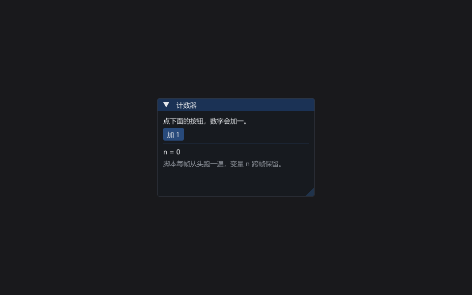

# KeelUI

Keel 脚本的立即模式 ImGui 绑定：脚本里的 `ui.*` 指令在 `frame` 块中逐帧直接调用 Dear ImGui，不经过 Echo 的保留式对象树。

**依赖**：Keel（`keel/include`）、Dear ImGui 1.92+、`imgui_stdlib.h`。**不需要 Echo 头文件**——`KeelUI.hpp` 只 include `KeelFastIO.hpp`、`KeelLoader.hpp`、`KeelStd.hpp`、`imgui.h`、`imgui_stdlib.h`；Echo 只负责提供 `echo::App` 当宿主。

## 脚本约定

- 文件顶层是"序章"：装载后跑一次，只放 `fn` 定义与变量初始化。
- `fn startup { ... }` 装载后跑一次（可选）；`fn frame { ... }` 每帧跑一次（必需，缺了装载失败）。
- `ui.*` 是立即模式：没有回调和对象句柄，每帧一开始就要把整套控件从头调一遍。
- 变量跨帧保留（存在 VM 里），数据栈每帧清空。
- 表面语法下 `fn` 不带形参；需要跨块传值就靠变量或栈约定。

## 写法（表面语法最常踩的一个坑）

`ui.text "hi"` 这种"指令在前、操作数在后"的写法**不能跑**：语句开头的裸名字会被编译成
变量读取，运行时报 `undefined variable 'ui.text'`。两种能跑的写法：

```keel
ui.text("hi")              // 调用形式
"hi" ui.text               // 操作数在前，Forth 风格
```

混用时要留意：`str(n) concat ui.text` 里 `str(n)` 已经结束了一个语句，后面的 `concat`
又变成语句开头的裸名字，同样报错。嵌套调用最不容易出问题：
`ui.text(concat("n = ", str(n)))`。

另外 `if` / `while` 的条件必须是**单个表达式**，不能是一串指令：先 `let` 出来再判断
（`let clicked = ui.button(label)` + `if clicked { ... }`）。

## 指令表

共 26 条，无别名，注册名与下表逐字一致。栈效果左弹出、右压回，栈顶在右。

| 指令 | 栈效果 | 说明 |
| --- | --- | --- |
| `ui.begin` | `标题 宽 高 --` | 开窗口。宽高同时落在 (0,1] 视为占屏幕比例；≤0 取屏幕 80%；尺寸与居中仅首次生效，之后听用户拖拽 |
| `ui.end` | `--` | 关窗口；窗口计数为 0 时是空操作 |
| `ui.text` | `值 --` | 一行文本，任意值按 toString 输出 |
| `ui.textWrapped` | `值 --` | 按可用宽度自动折行 |
| `ui.textDim` | `值 --` | 灰色文本 |
| `ui.button` | `标签 -- 布尔` | 本帧被点击返回 true |
| `ui.selectable` | `标签 -- 布尔` | 本帧被点击返回 true |
| `ui.input` | `id -- 字符串` | 单行输入。标签被隐藏（内部用 `"##" + id`），输入缓冲按 id 持久保存，返回当前内容 |
| `ui.sameLine` | `--` | 下一个控件续在同一行 |
| `ui.separator` | `--` | 分隔线 |
| `ui.spacing` | `--` | 垂直留白 |
| `ui.childBegin` | `id 宽 高 --` | 带边框的滚动子窗口，宽高按像素 |
| `ui.childEnd` | `--` | 关子窗口 |
| `ui.scrollBottom` | `--` | 滚到当前区域底部 |
| `ui.tabBar` | `id -- 布尔` | 开页签栏，成功返回 true；false 时别写内容也别配 `ui.endTabBar` |
| `ui.tabItem` | `标签 -- 布尔` | 开一个页签，**只有被选中的页签**返回 true；false 时内容与 `ui.endTabItem` 都要跳过 |
| `ui.endTabItem` | `--` | 关页签 |
| `ui.endTabBar` | `--` | 关页签栏 |
| `ui.tableBegin` | `id 列数 -- 布尔` | 开表格（边框、行底色、可拖列宽、按比例拉伸），成功返回 true |
| `ui.tableSetup` | `标签 权重 --` | 定义一列（宽度拉伸，权重决定占比）；只该在 `ui.tableBegin` 返回 true 后调用 |
| `ui.tableHeaders` | `--` | 表头行 |
| `ui.tableRow` | `--` | 换到下一行 |
| `ui.tableCell` | `--` | 换到下一列 |
| `ui.tableEnd` | `--` | 关表格 |
| `ui.heading` | `值 --` | 带分隔线的标题 |
| `ui.plot` | `标签 列表 --` | 折线图（高 90）。列表里非数值项跳过，全空时显示 `(无数据)` |

文本类指令一律用 `toString` 取值，数字也能直接画；数值类指令接受数字、布尔和可解析为数字的字符串。

## 宿主怎么接



`keelui::Host` 是纯 C++ 结构体，`echo::App` 只管窗口、GL 与 ImGui 生命周期。完整可编译版本见 [`examples/host.cpp`](examples/host.cpp)：

```cpp
#include "echo/app.h"
#include "KeelUI.hpp"

int main()
{
    echo::App app;
    echo::AppConfig cfg;
    cfg.title = "KeelUI 宿主";
    if (!app.init(cfg))
        return 1;

    keelui::Host host;
    host.budget = 100000;               // 每帧步数上限（默认值）
    host.load("examples/counter.keel"); // 返回 false 时看 host.error

    while (app.running() && app.beginFrame())
    {
        host.frame();                   // 每帧只调这一句
        app.endFrame();
    }

    app.shutdown();
    return 0;
}
```

要点：

- `host.frame()` 必须在 `beginFrame()` 与 `endFrame()` 之间调用；每帧只有这一次调用，脚本的 `frame` 块、配对收尾、错误处理都在里面。
- `host.load(path)`：装载失败返回 false，`host.loaded == false`、`host.error` 是文本；`host.reload()` 用同一路径和语法重载。
- 装载失败后继续调 `host.frame()` 不会崩：它会画一个名为 `Keel UI` 的窗口显示 `host.error`。
- `before_install` 是 `std::function<void(keel::Keel &)>`，要在 `load()` 之前赋值，用于注册宿主自己的指令。
- 其余可读字段：`loaded`、`error`、`path`、`syntax`、`budget`、`last_steps`、`max_steps`（后两者记录上帧步数与历史峰值，便于调预算）。

## 不配对怎么办

`Host::run_block` 在每次跑完块（以及出错、超预算）后调用 `force_close`：按 表格 → 页签项 → 页签栏 → 子窗口 → 窗口 的顺序，把计数器里没配对的 `End*` / `End` 全部补掉，绝不让 ImGui 的断言带走整个 App。反向的冗余调用也被吞掉：`ui.end`、`ui.childEnd`、`ui.tableEnd`、`ui.endTabItem`、`ui.endTabBar` 在计数为 0 时是空操作。

每帧最多执行 `budget` 条指令（默认 100000）。步数用完块还没结束就停下，记错误文本"帧预算用完"，并把 `loaded` 置为 false——脚本卡死或死循环只会让界面变成错误提示，不会锁死主循环。

## 已知限制

- `fn` 不带形参；调用方只能按栈约定传值。
- `f.out` / `f.outln` / `f.err` 等 `f.*` 输出被丢弃，宿主侧接不到。
- `ui.input` 的缓冲只能由用户键盘输入改变，脚本无法写入初值。
- 指令集只覆盖"够画工具面板"的范围：没有菜单栏、弹窗、拖拽、图表之外的绘图 API。

## 示例

- `examples/counter.keel` —— 脚本示例（计数器），需要下面那个宿主来跑。
- `examples/host.cpp` —— 最小宿主可执行程序：`host.exe examples/counter.keel`。
  编译需要 Echo 的 `libecho.a` + Dear ImGui + GLFW，命令行见 [docs/BUILD.md](../docs/BUILD.md)。
